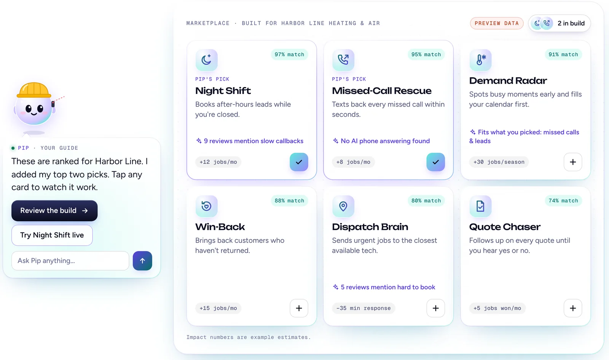
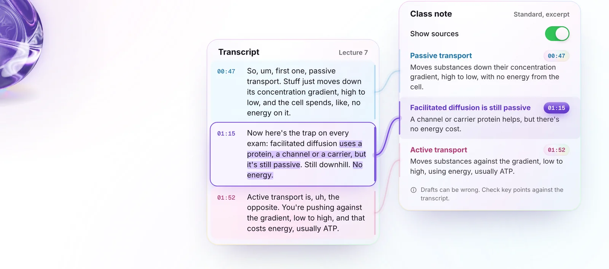

I'm a design engineer. I take AI products from the first flow to production on my own: the interface in React and TypeScript, the API routes and database behind it, and the prompts in between. I build in Claude Code every day and review what it writes before it ships. Right now that's two products, Pip and Lecivo.

<table>
  <tr>
    <td width="50%" valign="top">
      
      
<a href="https://pip-ai-drab.vercel.app"><b>Live site</b></a> · <a href="https://github.com/braydenscuffham2-coder/pip-ai">Code</a>

    </td>
    <td width="50%" valign="top">
      
      
<a href="https://lecivo-demo.lovable.app"><b>Interactive demo</b></a> · <a href="https://github.com/braydenscuffham2-coder/lecivo">Case study</a>

    </td>
  </tr>
</table>

## Pip

- Pip reads a business's homepage and up to 5 key pages, detects about 60 known chat, booking and review tools, and pulls in its Google reviews and nearby competitors. Claude structures what it found.
- The owner gets a coverage score and upgrades ranked by match %, each with the evidence behind it. Built with Next.js 16, React 19, TypeScript, Supabase, the Claude API and ElevenLabs.

## Lecivo

- An iPhone app that records a lecture and transcribes it on the phone with Apple's speech tools. Audio never leaves the phone, and transcript text goes to an AI only after the student agrees.
- Every class note and flashcard links back to the moment it was said. In App Store submission now.

## How I work

- **Claude Code every day, and I review what it writes.** Nothing it writes ships until I've read it.
- **Models suggest, code decides.** In Pip, Claude turns a messy website into structured facts. Plain code, not the model, does the scoring and ranking.
- **Show the evidence.** Every Pip recommendation names the review or gap that earned it, and every Lecivo note links to the line in the lecture it came from.

---

Boise area, Idaho · Business Administration at BYU–Idaho · Open to remote design-engineering roles

The header and cards above are drawn by code. See [`src/`](src).
