**Design engineer, open to remote design-engineering roles.** I take AI products from the first flow to production on my own: the interface in React and TypeScript, the API routes and database behind it, and the prompts in between. Right now that's two products, Pip and Lecivo.

[LinkedIn](https://www.linkedin.com/in/brayden-scuffham-299135440/) · [Pip on the web](https://pip-ai-drab.vercel.app) · [Lecivo demo](https://lecivo-demo.lovable.app)

<table>
  <tr>
    <td width="50%" valign="top">
      
      
<a href="https://github.com/braydenscuffham2-coder/pip-ai"><b>Code and write-up</b></a> · <a href="https://pip-ai-drab.vercel.app">Live site</a>

    </td>
    <td width="50%" valign="top">
      
      
<a href="https://github.com/braydenscuffham2-coder/lecivo"><b>Case study</b></a> · <a href="https://lecivo-demo.lovable.app">Interactive demo</a>

    </td>
  </tr>
</table>

## Pip

- An AI analyst for local businesses. It reads a business's site, detects about 60 known chat, booking and review tools, and pulls in its Google reviews and nearby competitors. Claude structures what it found, and plain code ranks the AI upgrades that fit, each with the evidence behind it.
- Runs in two places: inside the Claude app on the viewer's own plan, and on the web with Next.js 16, React 19, TypeScript, Supabase and the Claude API.

## Lecivo

- An iPhone app that records a lecture and transcribes it on the phone with Apple's speech tools. Audio never leaves the phone, and transcript text goes to an AI only after the student agrees.
- Every class note and flashcard links back to the moment it was said. In App Store submission now.

## Now

- **Lecivo:** in App Store submission.
- **Pip:** talking with local business owners about where their work gets stuck, and building the Brain, a staged scan where Claude proposes AI agents and plain code scores them.

**Recently shipped**

<!-- recent:start -->
- [Add a link preview image and Open Graph tags to the home page](https://github.com/braydenscuffham2-coder/pip-ai/commit/88a1a23de4a7f044d425f8c8eb78f75ec27539c9) · `pip-ai` · Nov 16
- [Portal: founder step controls, consent tools, cancel-and-delete, supervisor and runtime hooks](https://github.com/braydenscuffham2-coder/pip-ai/commit/49a2bdd1fcdc1530d1f07acaa6988f4f159a0d21) · `pip-ai` · Nov 16
- [Portal: drop stray empty nodes and show teammate names on setup steps](https://github.com/braydenscuffham2-coder/pip-ai/commit/d0e2623958aff8111a96a0c90bfb4e46ced102a8) · `pip-ai` · Nov 15
- [Add the Pip Portal page and require an email at Lock it in](https://github.com/braydenscuffham2-coder/pip-ai/commit/e66525878c1b1c6c99b435aeeb2a49180838ca34) · `pip-ai` · Nov 15
- [Add a readiness check and refusal logs to /api/sample](https://github.com/braydenscuffham2-coder/pip-ai/commit/e9c5ccbd5f477334a3a2666a845d0016912e496b) · `pip-ai` · Nov 15
<!-- recent:end -->

Updated daily from my public commits by a GitHub Action in this repo.

## How I work

- **Claude Code every day, and I review what it writes.** Nothing it writes ships until I've read it.
- **"Complete" means it works where people will actually use it.** For Lecivo, that meant testing interruptions, unclear transcripts, and keeping existing recordings safe, not just the happy path.
- **Understand the work before adding AI.** In Pip, Claude turns a messy website into structured facts, plain code does the scoring, and every recommendation names the review or gap that earned it.

## Writing

Short posts on LinkedIn about what I'm building and why:

- [You can leave a lecture with every word recorded and still miss the point.](https://www.linkedin.com/feed/update/urn:li:activity:7526344191107448832/) On what Lecivo is for.
- [A business can become so good at working around a problem that it stops recognizing the problem.](https://www.linkedin.com/feed/update/urn:li:activity:7525998011970203648/) On deciding where AI belongs in a business.
- ["Complete" should mean it works where people will actually use it.](https://www.linkedin.com/feed/update/urn:li:activity:7524263059880779776/) On what counts as done.

---

Boise area, Idaho · Business Administration at BYU–Idaho · [LinkedIn](https://www.linkedin.com/in/brayden-scuffham-299135440/)

The header and cards above are drawn by code in [`src/`](src).
